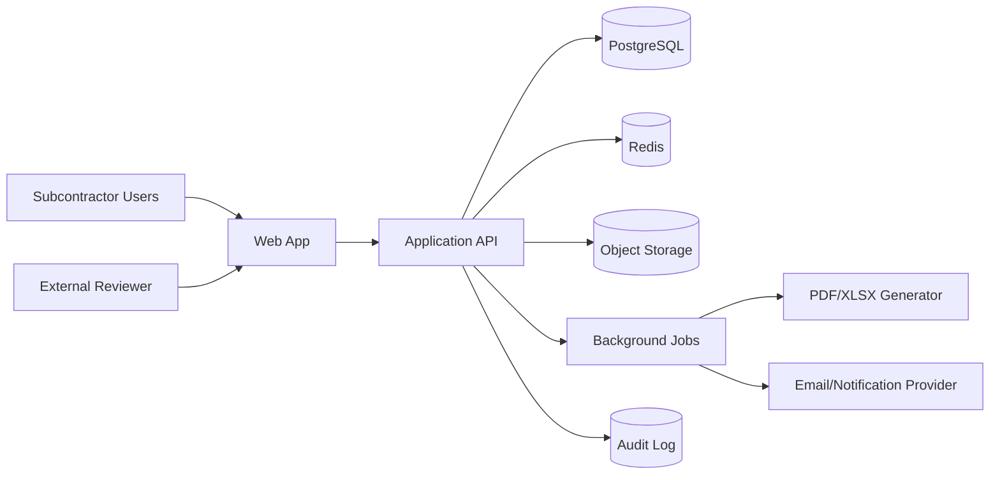

# System Architecture

## 1. Architecture style

Use a **modular monolith** for MVP. Keep domain boundaries explicit so modules can be extracted later if scale or organizational needs justify it.

## 2. Reference stack

### Monorepo

- pnpm workspaces
- Turborepo
- TypeScript

### Web application

- Next.js with App Router
- React
- Tailwind CSS
- shadcn/ui or equivalent accessible component primitives
- TanStack Query
- TanStack Table
- React Hook Form
- Zod
- i18next or equivalent localization library

### API

- NestJS
- REST API under `/api/v1`
- OpenAPI documentation
- Prisma ORM or a comparable typed ORM
- PostgreSQL
- Redis
- BullMQ or comparable job queue

### Storage and infrastructure

- S3-compatible object storage
- Docker for local and production packaging
- Reverse proxy / managed load balancer
- Managed PostgreSQL for production when budget permits
- Error tracking and metrics platform

Versions should be pinned to stable supported releases at implementation time.

## 3. Context diagram



## 4. Backend modules

- Identity
- Organizations and memberships
- Clients and contacts
- Projects
- Contracts and amendments
- BOQ
- Valuation periods and progress
- Payment applications
- Variations
- Certificates
- Invoices and payments
- Retention and advances
- Documents and comments
- Notifications
- Reporting and forecast
- Audit
- Subscription and billing placeholder

## 5. Layering

Each module should contain:

```text
module/
  domain/          entities, value objects, domain services, rules
  application/     commands, queries, use cases, DTO contracts
  infrastructure/  repositories, ORM mappings, adapters
  presentation/    controllers and request validation
```

Do not place commercial calculations in controllers, React components, or database triggers.

## 6. Multi-tenancy

Use a shared database and shared schema with `tenant_id` on all tenant-owned tables.

Defense in depth:

1. Tenant resolved from authenticated membership.
2. Application query filters enforce tenant ID.
3. Repository interfaces require tenant context.
4. PostgreSQL Row-Level Security may be enabled before general availability.
5. Cross-tenant integration tests are mandatory.

## 7. Background jobs

Use the queue for:

- BOQ import processing
- PDF/XLSX export
- Virus scanning and file processing
- Email notifications
- Dashboard materialization if needed
- Scheduled overdue and retention alerts

Jobs must be idempotent and retryable.

## 8. Calculation engine

Create a shared domain package for:

- BOQ line valuation
- Cumulative progress
- Retention calculation and cap
- Advance-payment recovery
- Tax and deduction order
- Payment application totals
- Certified variance
- Invoice balance
- Aging and forecast

Every formula requires unit tests using explicit examples.

## 9. Reporting

- Generate reports from immutable payment-application versions.
- Store generated artifacts with checksum and template version.
- Support English and Arabic templates.
- Display a calculation breakdown in UI and exports.

## 10. Future integration boundary

Prepare adapter interfaces for:

- Accounting systems
- E-invoicing providers
- Cloud storage
- WhatsApp/SMS
- ERP and project-management systems
- Digital signatures

Do not implement integrations before validated demand.
