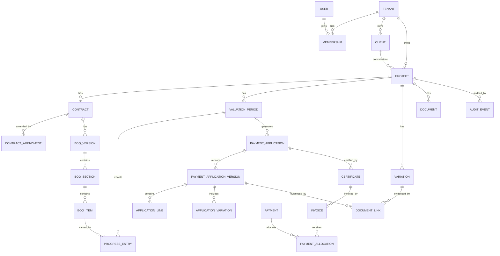

# Data Model

## 1. Core modeling decisions

- UUID primary keys
- `tenant_id` on every business table
- Exact decimal or integer minor-unit representation for money
- UTC timestamps with project timezone stored separately
- Soft deletion only for non-financial drafts; submitted financial records are never deleted
- Version rows for contracts, BOQs, and payment applications
- Separate claimed, certified, invoiced, and paid values

## 2. High-level ERD

## 3. Key entities

### Tenant

Represents the customer organization.

Key fields:

- id
- name
- legal_name
- default_currency
- default_locale
- timezone
- status

### Project

- client_id
- name and reference
- country
- currency
- timezone
- reporting locale
- start and planned completion dates
- status

### Contract

- project_id
- contract reference
- original value
- current approved value
- tax configuration
- retention rate and cap
- advance amount and recovery rule
- payment terms
- valuation method
- effective dates

### BOQ item

- hierarchy and code
- description in English and Arabic
- unit
- baseline quantity
- rate
- baseline amount
- item type
- valuation limits

### Progress entry

Stores previous, current, and cumulative quantity/value for one BOQ item and period.

### Payment application

Stable business identity and sequence number. Versions store submitted snapshots.

### Variation

Stores commercial lifecycle and multiple value dimensions:

- estimated value
- quoted/submitted value
- approved value
- certified-to-date value

### Certificate

Stores official or client-issued certification against a payment application.

### Invoice and payment

Invoices track receivables. Payments are independently recorded and allocated.

## 4. Money model

Preferred approach:

- Store money in PostgreSQL `numeric(20,4)` for multi-currency construction calculations.
- Use a decimal library in application code.
- Round only at configured presentation or contractual calculation points.
- Store currency code with each financial record.

Never use JavaScript `number` directly for persisted financial arithmetic.

## 5. Versioning

### Payment applications

- `payment_application` contains identity, number, current version, and lifecycle status.
- `payment_application_version` contains a complete immutable financial snapshot.
- Revisions link through `supersedes_version_id`.

### BOQ

- Draft import can be edited.
- Publishing creates a version.
- Amendments create a new version or adjustment layer.

## 6. Audit

Critical domain events include:

- Contract published
- BOQ published
- Progress changed after internal approval
- Payment application submitted, withdrawn, or revised
- Certificate finalized
- Invoice issued or cancelled
- Payment recorded or reversed
- Variation approved, rejected, or disputed
- Role or permission changed
