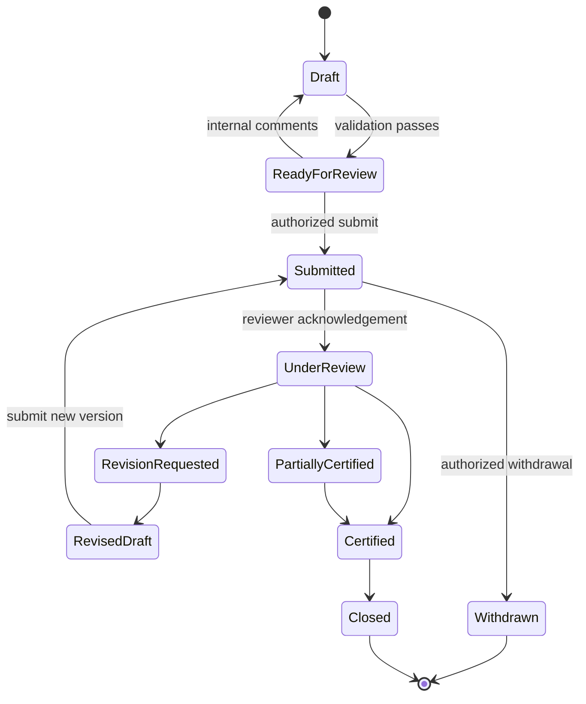
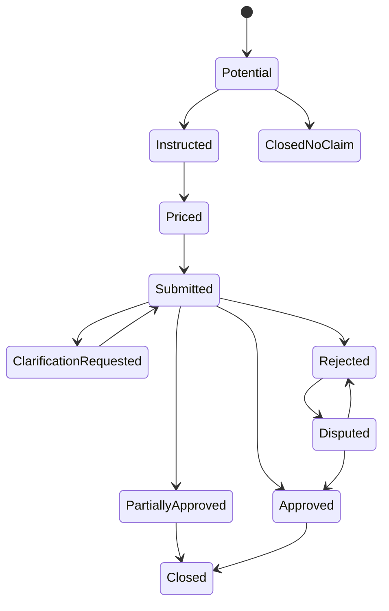
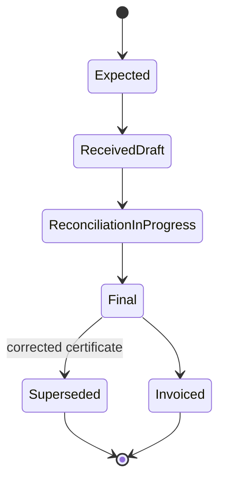
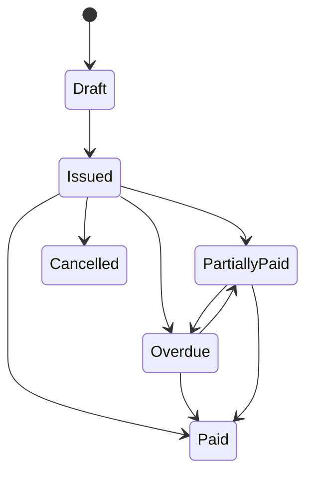

# Workflows and State Machines

## 1. Payment application workflow



### Rules

- Submitted versions are immutable.
- A revision creates a new version linked to the previous version.
- Only one version may be marked current.
- Certification stores claimed and certified figures separately.
- Closing requires certificate data or an explicit no-certificate exception.

## 2. Variation workflow



### Rules

- Potential value, submitted value, and approved value are separate fields.
- Evidence completeness is displayed but does not automatically establish entitlement.
- Inclusion in a payment application depends on configured project rules and user authorization.

## 3. Certificate workflow



## 4. Invoice workflow



## 5. Contract baseline workflow

- Draft
- Validated
- Published
- Superseded by amendment
- Closed

A published BOQ baseline cannot be edited directly. Changes require an amendment or controlled correction with audit history.

## 6. Monthly commercial cycle

```text
Open valuation period
→ capture progress
→ reconcile previous quantities
→ include eligible variations/materials
→ calculate retention/advance/tax/deductions
→ internal review
→ submit application
→ respond to comments
→ record certificate
→ issue invoice
→ track payment
→ update forecast and aging
```
